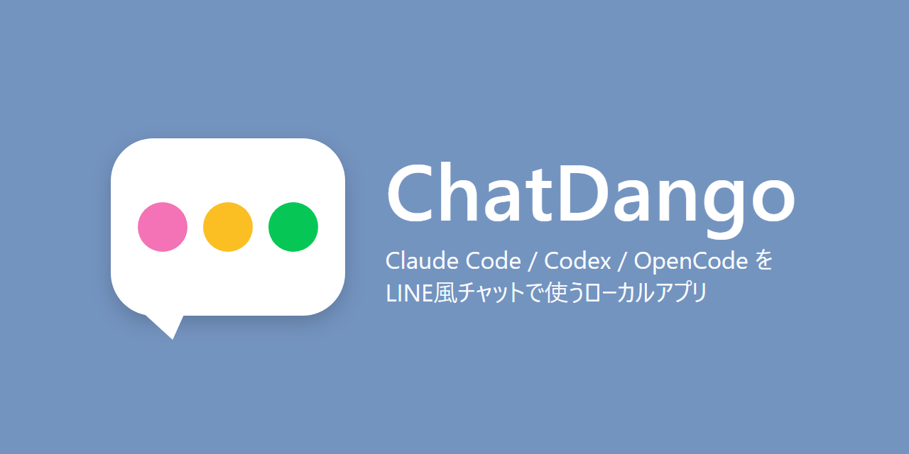
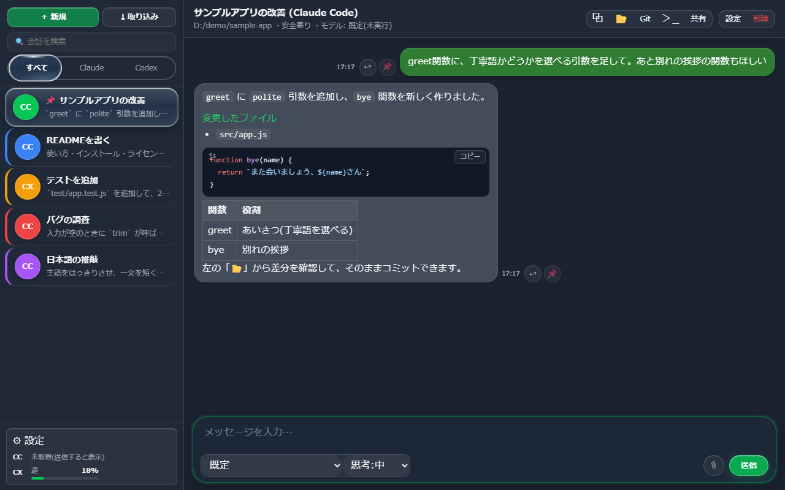
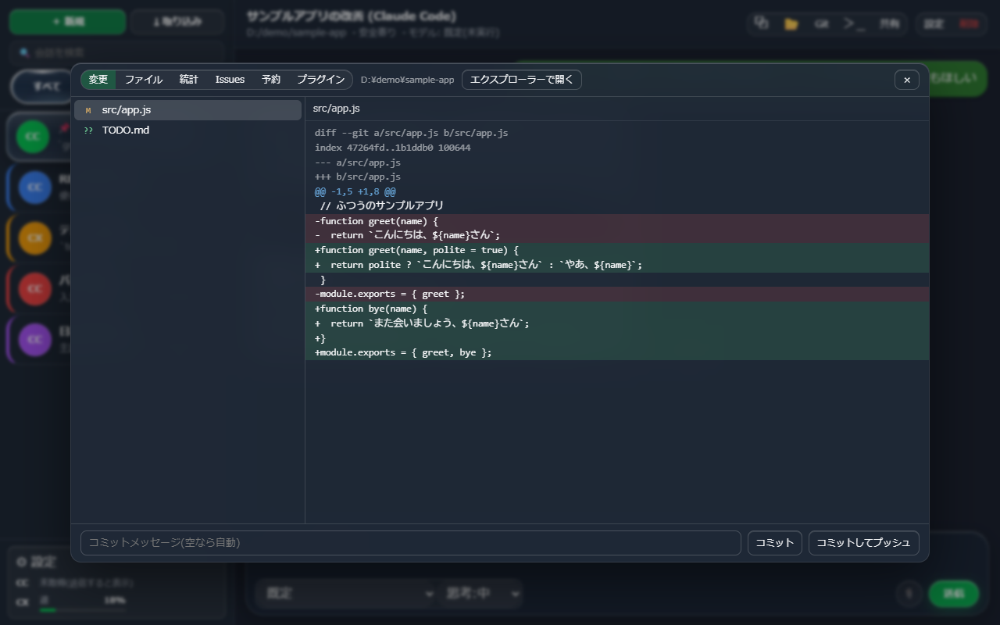

# ChatDango

<p align="center"></p>

Claude Code と Codex を、LINE のようなチャット画面で使うローカルアプリです。
会話に名前を付けて並べて管理でき、続きから話すと自動で resume(再開)されます。
PC のブラウザだけでなく、スマホ(Tailscale 経由)からも使えます。

依存パッケージはありません。Node.js だけで動きます。

https://github.com/user-attachments/assets/06bed73d-c021-4320-85b3-ee02968d075b

> 紹介動画(約4分)。音声: VOICEVOX:ずんだもん / 動画内で紹介している yomiyasu は nanaism さんの作品です。





> 画像は、デモ用の空のフォルダと架空の会話で撮ったものです。

## 必要なもの

- **Windows**(10 / 11)。起動・フォルダを開く・PowerShell の起動などが Windows 専用のため、Mac や Linux では動きません
- **Node.js 20 以上**
- Claude Code CLI(`claude`)や Codex CLI(`codex`)のうち、使うもの
- GitHub 連携を使う場合は GitHub CLI(`gh`)
- yomiyasu の補助チェックを使う場合は Python 3(無くても、アプリ本体と推敲は使えます)
- 「AIで生成」(アイコン)を使う場合は Codex CLI

## 起動

```
start.bat
```

サーバーを起動して、`http://127.0.0.1:5178` を開きます。Brave・Edge・Chrome のどれかがあれば、タブのないアプリ風の画面で開きます。
なければ、既定のブラウザで開きます。

サーバーは黒い窓を出さずに裏で動きます。再起動は画面の設定にある再起動ボタンで行い、止めたいときはタスクマネージャーで `node.exe` を終了してください。

サーバーだけを裏で起動したいときは `server-hidden.vbs` を使います。
スタートアップに登録すると、ウィンドウなしで自動起動します。

## 主な機能

- **会話の管理**: 名前・色・アイコン・背景色・グループ・ピン留め・並べ替え
- **resume**: 会話ごとに常駐プロセスを持ち、続きから話せます
- **返信(引用)とピン**: メッセージへの返信、重要なメッセージのピン留め
- **取り込み**: 既存の Claude Code / Codex のセッションを取り込めます(自然文での AI 検索つき)
- **アーカイブして新しいチャットへ**: 会話を gzip で保存し、引き継ぎ資料を持った新しい会話を始めます
- **長い会話への対応**: 直近 80 件だけ描画し、上へスクロールすると古い分を読み込みます
- **コンテキスト使用率**と、Claude Code / Codex の**トークン残量**の表示
- **作業フォルダを開く**、PowerShell / CMD の起動(PC 本体からのみ)
- **GitHub 連携**: 非公開リポジトリの作成・コミット・プッシュ、リポジトリページへのリンク
- **別ウィンドウへの切り離し**: 会話をポップアップに出せます(PC のみ)
- **完了音**: 返答の完了を音で知らせます(設定可・スマホ対応)
- **画像添付**、Markdown 表示、モデル・思考の深さの選択
- **コードの色付けと Markdown**: コードブロックを言語ごとに色付けします(設定の「見た目」でオフにできます)。会話ごとに「書式指示」(Claude のみ)をオンにすると、AI が見出し・表・コードブロックで返し、大事な語に `{赤:語}` のような色を付けます
- **背景テンプレート**: 設定 → 見た目 に、オーロラ・夕焼け・星空・海・雨・ラバ・さくらの7つ(ファイル不要の動く背景)を用意しています。画像や動画も従来どおり追加できます。
- **yomiyasu**: 日本語の推敲スキルを、会話ごとに作業フォルダへ入れたり外したりできます。補助チェックには Python 3 が必要です(推敲だけなら無くても使えます) 設定 → アプリ →「yomiyasu」の「最新版に更新」で、公式(nanaism/yomiyasu)の最新リリースに更新できます(ボタンを押したときだけ通信。入れてあるチャットのコピーも入れ替わります)。
- **見た目の設定**: 背景の画像・動画、フォントファイル(ttf / otf / woff / woff2)、文字サイズ
- **作業パネル**(ヘッダーの 📂): 作業フォルダの中身を、AI を介さずに直接扱えます
  - **変更**: 変更のあるファイルの差分を見て、コミット・プッシュできます(パスワードなど秘密らしいファイルの差分は出しません)
  - **ファイル**: フォルダ内のファイルを開いて編集・保存できます(1MB 超とバイナリは不可。`.git` は開けません)
  - **統計**: ファイル数・行数・種類ごとの内訳・大きいファイル・最近の変更
  - **Issues**: GitHub Issues を「未着手/進行中/完了」のボードで見て、移動・新規作成できます(書き込みは非公開リポジトリのみ)
  - **予約**: 決めた時刻や間隔で、会話に自動でプロンプトを送ります(サーバーが動いている間だけ)
  - **プラグイン**: `plugins/` に置いた JS で、画面にボタンなどを足せます。既定ではすべて無効です(書き方は `plugins/README.md`)
- **ターミナル**(ヘッダーの `>_`): ブラウザ内の PowerShell。複数のタブを開けます(PC 本体からのみ。Windows x64)
- **ガラス風の見た目**: 選択中のタブや会話が、屈折するガラスのように表示されます(屈折は Chromium 系ブラウザのみ。他は通常のぼかし表示)
- **設定**: メモリの節約モード、サーバーの再起動、アーカイブ一覧

## スマホから使う

Tailscale で PC とスマホを同じネットワークにつなぎ、PC の Tailscale アドレスの
ポート 5178 を開きます。外部からのアクセスには合言葉が必要です。
PowerShell / CMD の起動、ターミナル、ファイルの書き込み・会話の削除などは、PC 本体のブラウザからしかできません(スマホからは画面に出ても拒否されます)。ただし、合言葉を知っていれば、会話を通じて AI にコマンドを実行させられるので、実質的には PC を操作できます。

## 構成

| ファイル | 役割 |
| --- | --- |
| `server.js` | HTTP と SSE のサーバー本体(ポート 5178) |
| `public/index.html` | 画面(HTML・CSS・JS を 1 ファイルにまとめています) |
| `git-ops.js` | GitHub 連携の処理 |
| `importer.js` | 既存セッションの取り込み |
| `public/hl.js` | コードブロックの色付け(外部ライブラリなし) |
| `lib/` / `test/` | 認証・接続元の判定・ファイル操作・予約・プラグイン・ターミナルなどの部品と、そのテスト |
| `public/work/` | 作業パネル(変更・ファイル・統計・Issues・予約・プラグイン) |
| `public/term/` / `vendor/node-pty/` | ブラウザ内ターミナル(任意機能。消しても他は動きます) |
| `plugins/` | プラグイン置き場とサンプル(`hello`) |
| `docs/` | README 用の画像 |
| `vendor/yomiyasu/` | 同梱している yomiyasu(MIT。下の「ライセンスと第三者の表記」を参照) |
| `THIRD_PARTY_NOTICES.md` | 同梱している第三者ソフトウェアの一覧 |
| `make-icon.js` | アイコン `icon.ico` を描いて作ります(`node make-icon.js`) |
| `start.bat` / `server-hidden.vbs` | 起動用 |
| `SPEC.md` | 仕様と開発メモ |
| `data/` | 会話の履歴・アーカイブ・添付画像(Git の管理対象外) |

## 安全に使うために

- このアプリは、AI にコマンドを実行させるリモート操作の道具です。**合言葉を知っている人は、あなたの PC を操作できます。** 合言葉(`data/auth.json`)は人に教えないでください。
- 待ち受けは自分の PC(127.0.0.1)と Tailscale のアドレスだけです。Tailscale の Funnel や、ルーターのポート開放でインターネットに出さないでください。
- 新しい会話の権限は「安全寄り」が既定です。「全許可」は AI が確認なしでファイル編集やコマンド実行をします。内容を理解して、必要な会話だけで選んでください。
- PowerShell / CMD の起動、ターミナル、ファイルの書き込みなどの画面操作は、PC 本体のブラウザからしかできません。ただし、フォルダ一覧、Git 操作、過去の会話の取り込みなどは、合言葉を知っていればスマホからも使えます。
- このアプリは、自分だけが使う PC で動かす前提です。複数人で共有する PC やサーバーには置かないでください。
- ファイル編集は UTF-8 のファイルだけ開けます(Shift_JIS などは、保存で文字化けするため開けません)。
- 「プラグイン」は、置いた JS をそのまま画面で実行します。出どころの分からないプラグインは有効にしないでください。
- 「予約」したプロンプトは、その会話の権限設定のまま自動で送られます。「全許可」の会話には予約しないことをおすすめします。

## Claude Code に設定を頼むとき

リポジトリを `git clone` して、Claude Code に「README を読んでこのアプリを動かして」と頼めば進められます。
前提は Windows と Node.js 20 以上だけで、起動は `start.bat`(または `npm start`)です。`data/` と合言葉は初回の起動で自動的に作られます。

## 非公式ツールです

これは個人が作った非公式のツールで、Anthropic 社(Claude)や OpenAI 社(Codex)とは関係ありません。
Claude Code / Codex の利用料や利用規約は、それぞれ自分の契約が対象です。

## 自己責任で使ってください

AI にファイル編集やコマンド実行をさせる道具です。使って生じた損害(データの消失、利用枠の消費など)について、作者は責任を負いません。
大事なフォルダは、バックアップを取ってから使ってください。

## うまく動かないとき

- `Node.js not found` と出る → https://nodejs.org からインストールしてください。
- 会話を送ると「Claude Code(または Codex)が見つかりません」と出る → そのAIのCLIが入っていないか、ログインしていません。PowerShell で `claude --version` や `codex --version` が動くか確認してください。
- 画面が開かない → ブラウザで `http://127.0.0.1:5178` を直接開いてください。

## ライセンスと第三者の表記

- このアプリ本体は MIT ライセンスです。詳しくは `LICENSE` を見てください。
- `vendor/yomiyasu/` には、nanaism 氏の **yomiyasu**(日本語の推敲スキル、v2.0.1、MIT ライセンス)をそのまま同梱しています。
  著作権表示とライセンス文(`vendor/yomiyasu/LICENSE`、`UNICODE-LICENSE.txt`)は消さずに、一緒に配布してください。
  出どころは `vendor/yomiyasu/VENDORED.txt` に書いてあります。https://github.com/nanaism/yomiyasu
- Claude / Claude Code は Anthropic 社、Codex は OpenAI 社、Tailscale は Tailscale Inc.、Brave は Brave Software 社の名称または商標です。
  このアプリは各社と関係のない非公式のツールで、各社の CLI を呼び出すだけです。アカウントやログインは、使う人それぞれのものです。
- ブラウザ内ターミナルのために、xterm.js(`public/term/`)と node-pty(`vendor/node-pty/`)を同梱しています。どちらも MIT ライセンスです(一覧は `THIRD_PARTY_NOTICES.md`)。npm のパッケージとしての依存はなく、ターミナルが不要なら削除できます。

## メモ

- 設定やサーバー側(`server.js`)を変えたあとは、「設定 → サーバーを再起動」を押します。
  HTML だけの変更は、ブラウザの再読み込みで反映されます。
- `data/` には会話の内容が入るので、公開しないでください。
- テスト: `npm test`(パッケージのインストールは不要です)。
- 詳しい仕様と変更履歴は `SPEC.md` にあります。
